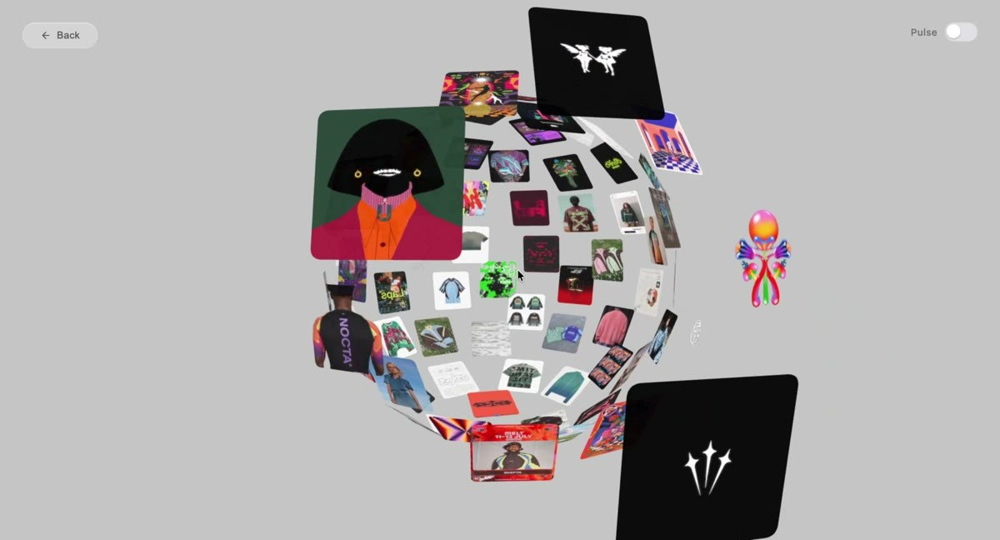

# Joel Meshak Portfolio

I designed and built an interactive archive of my fashion, visual design and digital work. The Vault organizes projects into collections, and Mind Map brings together the references that shape how I work.

[Open the portfolio](https://joelmeshak.com/) · [Read the case study and watch Mind Map in motion](https://athousandislands.tech/creative-portfolio/)

## Try it

Enter the Vault and open Mind Map. Drag to explore the globe. On a phone, hold to bring the images under your finger forward. The mobile map also responds to the arrow keys and Space. On desktop, Pulse adds optional camera-based hand controls.

## Milestones

### August 2026 · Built the first interactive archive

I gave the portfolio the feel of opening a collection. The 3D folders made the different parts of my practice feel connected while giving each body of work its own space. [Early build](https://github.com/athousandislands/joelmeshakportfolio/commit/7704a85)

### 13 October 2026 · Made the portfolio easier to extend

I split the original page into desktop, mobile and shared code. A repeatable media workflow now creates smaller image variants, video posters and folder thumbnails. Adding artwork has a clearer path, and GitHub Actions checks the assets, runs tests and verifies the build on pull requests and pushes. [Launch preparation](https://github.com/athousandislands/joelmeshakportfolio/pull/2)

### 13–14 October 2026 · Brought Mind Map to phones

I adapted the desktop globe for touch. Dragging turns it, and holding brings nearby cards forward. The map remembers where you left it during a visit and pauses rendering while you browse elsewhere. If the full scene fails to load, visitors can retry or open a smaller version. [Mobile Mind Map](https://github.com/athousandislands/joelmeshakportfolio/commit/e507730) · [Return and discovery refinements](https://github.com/athousandislands/joelmeshakportfolio/pull/3)

### 14 October 2026 · Put the projects first on mobile

Project images get priority. Mind Map can prepare in the background once those image requests settle, when the connection allows it. I added progress feedback for the map and a short swipe cue for the Gallery. That cue becomes still when reduced motion is enabled and disappears once you start browsing. [Mobile loading and Gallery updates](https://github.com/athousandislands/joelmeshakportfolio/pull/4)

## Next up

Check loading and repeat visits on physical iPhones and Android phones, then test the desktop Pulse permission and retry flow on the browsers the portfolio supports.

## Development

Use Node.js 24. Run `npm ci` and `npm run dev`. Run `npm test`, `npm run check:assets` and `npm run build` to verify changes. The [development guide](docs/development-guide.md) covers the source layout and media workflow.
